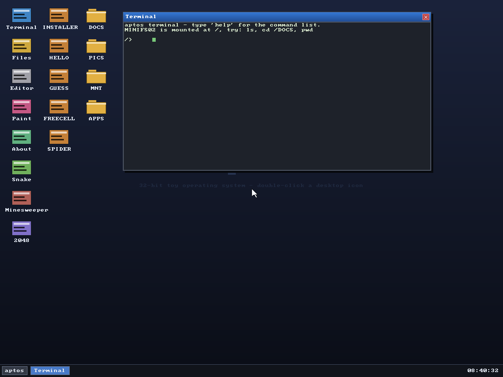
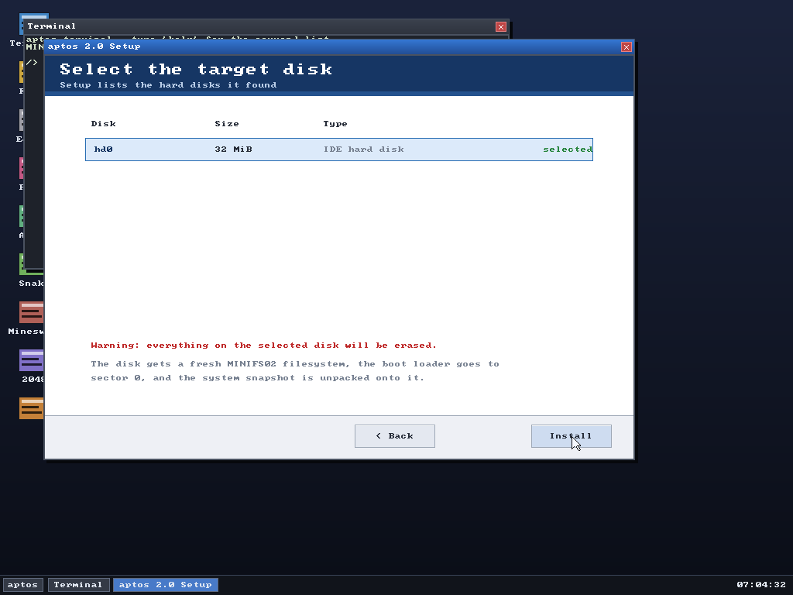
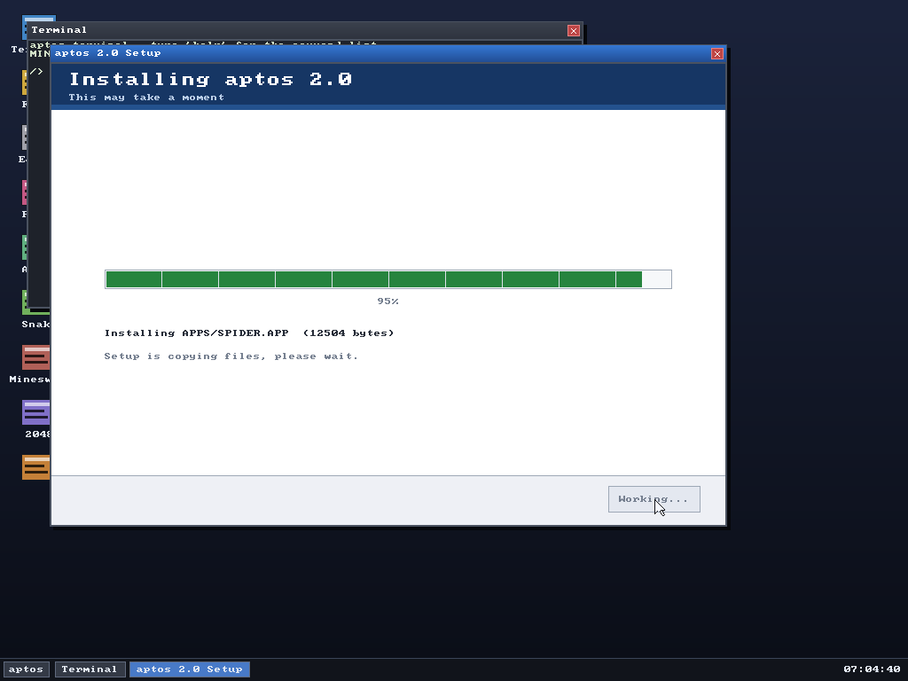
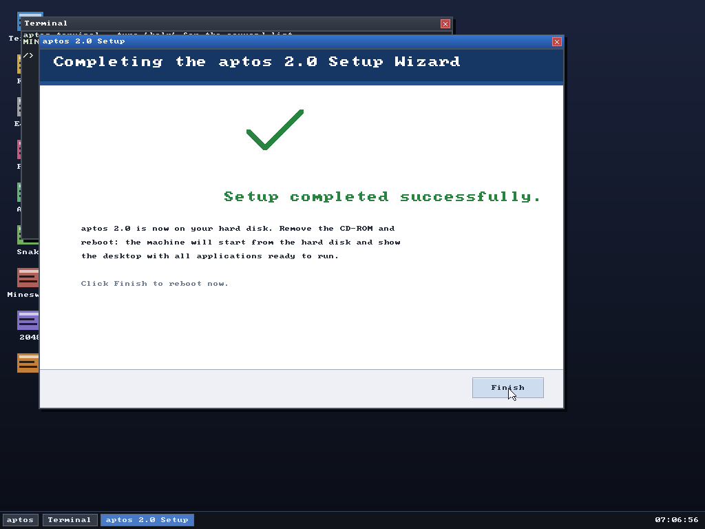
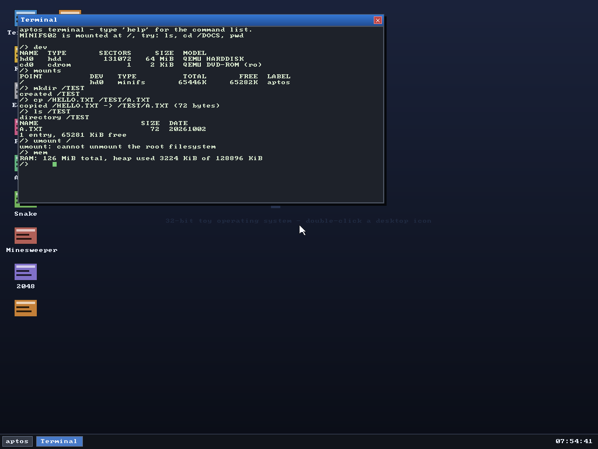

# aptos 2.0 用户手册

一份从零开始的用户使用规范 + 快速上手。面向**使用者**，不要求你会写代码。

---

## 目录

1. [这是什么](#1-这是什么)
2. [五分钟上手](#2-五分钟上手)
3. [桌面与窗口操作规范](#3-桌面与窗口操作规范)
4. [终端命令参考](#4-终端命令参考)
5. [内置应用与按键](#5-内置应用与按键)
6. [磁盘、挂载与格式化](#6-磁盘挂载与格式化)
7. [安装系统（光盘 → 硬盘）](#7-安装系统光盘--硬盘)
8. [应用包 `.lst` 与用户程序](#8-应用包-lst-与用户程序)
9. [使用规范与约定](#9-使用规范与约定)
10. [常见问题与排查](#10-常见问题与排查)
11. [已知限制](#11-已知限制)

---

## 1. 这是什么

aptos 2.0 是一个 32 位 x86 的**独立小操作系统**：自己的引导程序、自己的内核、
自己的文件系统、自己的窗口管理器，**不是 Linux 发行版**，也不跑 Linux 程序。

你能用它做的：

* 图形桌面：窗口可拖动、可缩放、可关闭，任务栏 + 开始菜单 + 实时时钟
* 桌面图标：**系统应用**和**你装的应用**都在桌面上，点一下就跑
* 终端：40 多条命令，能管文件、管磁盘、跑程序
* 硬盘 / 光盘 / 软盘三种介质，能挂载、能格式化、能互拷
* **用户态（ring 3）**：装的应用程序以普通用户权限运行，崩溃不影响系统
* 装系统：一张光盘镜像，向导式安装到硬盘

---

## 2. 五分钟上手

### 2.1 只想看看（不装）

```bash
qemu-system-i386 -m 128 -vga std \
  -drive file=os.img,format=raw,index=0,media=disk
```

开机直接进桌面。**内存 8 MiB 到 2048 MiB 都能跑**，`-vga std` 是必须的（需要 VBE 线性帧缓冲）。



### 2.2 从光盘装到硬盘（推荐流程）

```bash
# 1) 先造一块空硬盘（32 MiB 起步，建议 ≥ 256 MiB）
qemu-img create -f raw disk.img 512M

# 2) 挂上安装光盘从光驱引导
qemu-system-i386 -m 128 -vga std \
  -cdrom aptos-install.iso \
  -boot d \
  -drive file=disk.img,format=raw,index=0,media=disk
```

看到向导后：**Next → 选盘 → Install → Finish**（Finish 会重启）。

| 选盘 | 安装中 | 完成 |
|---|---|---|
|  |  |  |

```bash
# 3) 拔掉光盘，从硬盘启动
qemu-system-i386 -m 128 -vga std \
  -drive file=disk.img,format=raw,index=0,media=disk
```

### 2.3 在手机上跑（Limbo PC Emulator）

| 设置项 | 值 |
|---|---|
| CPU | **486 或 Pentium** |
| 内存 | **≥ 32 MiB**（16 MiB 也能开） |
| 显卡 | **std / Bochs VBE** |
| 硬盘 | `os.img`，类型 **raw / hd** |
| 光驱 | `aptos-install.iso`（装系统时） |

传文件时用 `os.img.gz`（115 KB）比原图省流量。

---

## 3. 开机画面

开机时**屏幕上不再滚动日志**，取而代之的是一段动画：

- 中间是 aptos 标志，外面套三层圆环，**有一个亮点绕着圆环转**
- 下面一条进度条，**进度是真实的** —— 每完成一项初始化就往前推一格
- 进度条下面显示当前在做什么，**中英文同时显示**（所以还没选语言也能看懂）
- 进度条下面有一排小圆点，走过的步骤会依次点亮
- 全部就绪后显示到 100%，然后**淡出**进入桌面

整个画面大约停留 **2.6 秒**。如果你觉得等太久，可以调
`kernel/splash.c` 里的 `SPLASH_MIN_TOTAL_MS`（改成 `0` 就是"能多快就多快"），
以及 `SPLASH_MIN_FRAMES`（每一步至少画几帧动画）。

**日志没有消失**，只是**不再往屏幕上打**了 —— 它们照常从**串口**
（COM1，115200 8N1）输出。用 QEMU 的话加 `-serial file:boot.log` 就能存下来：

```
qemu-system-i386 -hda build/os.img -serial file:boot.log
```

### 想临时把日志打回屏幕

开机时在 `kernel/kmain.c` 里把 `klog_screen(0)` 改成 `klog_screen(1)`
并且去掉 `splash_begin()`，就回到以前的纯文字启动界面。

## 4. 桌面与窗口操作规范

### 3.1 鼠标

| 操作 | 效果 |
|---|---|
| 单击桌面图标 | 启动该应用（系统应用开窗口，已装应用在 ring 3 里跑） |
| 拖动标题栏 | 移动窗口 |
| 单击窗口任意处 | 该窗口置顶并获得键盘焦点 |
| 点标题栏右上角 `X` | 关闭窗口 |
| 单击任务栏按钮 | 把该窗口提到最前 |
| 单击左下角 `aptos` | 打开开始菜单（所有系统应用） |

> 桌面图标分两列：**左列是系统应用**，**右列是 `/APPS` 里的应用**。
> 装完新应用**两秒内自动出现**，不用重启。

### 3.2 键盘

| 按键 | 效果 |
|---|---|
| 直接打字 | 输入到**当前焦点窗口** |
| `↑` / `↓` | 终端里翻命令历史 |
| `Ctrl+S` | 编辑器里保存文件 |
| `Esc` | 多数应用里表示取消/退出 |
| `F1` | **中英文界面切换**（也可 `Ctrl+Alt+L`） |

> **焦点规则**：键盘永远只发给置顶窗口。在别的窗口上点一下即可切换。

### 3.3 中英文切换

aptos 2.0 的界面有**中文 / 英文**两套文案，随时可切，不用重启：

| 怎么切 | 说明 |
|---|---|
| 按 `F1` | 最快；在任何窗口里都有效（用户程序里也行） |
| `Ctrl+Alt+L` | 同上，给不支持 F1 的模拟器用 |
| 开始菜单最下面一项 | 写着 `语言 (F1)`，右边显示当前语言，点一下切换 |
| 终端 `lang zh` / `lang en` | 终端里切；`lang` 单独敲会打印用法 |

窗口标题、任务栏、桌面、开始菜单、终端提示与 `help` 列表、文件管理器、编辑器、
画板、小游戏、关于窗口，以及光盘安装向导和软件包安装器的界面**全部跟着切**。
装到硬盘上的系统会把选择记在 `/LANG.CFG`，下次开机保持上次的语言。

> 中文用 16×16 点阵显示，比英文的 8×8 宽一倍，所以中文界面下行的间距会自动加大
> （终端行数会少一些，终端窗口本身也更高一点），这是正常的。

### 3.4 窗口

* 标题栏显示应用名（中文界面下就是中文名，比如 `终端` / `文件` / `编辑器`），任务栏同步显示
* 窗口可以拖到屏幕外再拖回来（有限位保护）
* 同时可开多个窗口，点谁谁在前

---

## 5. 终端命令参考

终端是默认打开的应用。提示符是 `/>`，显示当前目录。**按 `help` 会列出全部命令。**



上图这一段实测会话（`dev` / `mounts` / `mkdir` / `cp` / `ls` / `umount /` / `mem`）
的输出和本文档下一节的描述完全一致。

### 4.1 文件操作

| 命令 | 说明 |
|---|---|
| `ls [路径]` | 列目录；目录项标 `<DIR>` |
| `cd <路径>` / `pwd` | 切换目录 / 显示当前路径 |
| `cat <文件>` | 显示文件内容 |
| `write <文件> <文本>` | 新建或覆盖文件（**立即落盘**） |
| `mkdir <名字>` | 建目录 |
| `rm <名字>` | 删文件或空目录 |
| `cp <源> <目标>` | 复制文件 |
| `mv <源> <目标>` | 改名或移动 |

路径规则：**绝对路径**（`/DOCS/NOTES.TXT`）、**相对路径**（`DOCS/NOTES.TXT`）、
`.`、`..` 都支持；**不区分大小写**，但存盘时统一用大写。

### 4.2 系统与信息

| 命令 | 说明 |
|---|---|
| `help` | 命令列表 |
| `clear` | 清屏 |
| `echo <文本>` | 回显 |
| `df` | 文件系统用量 |
| `mem` | 内存用量 |
| `memtest [MiB]` | **分配并逐页校验**内存（默认 16 MiB） |
| `dmesg` | 内核启动日志 |
| `date` / `time` | 硬件时钟 |
| `uptime` | 运行时长 |
| `ver` | 版本 |
| `gfx` | 显示信息（分辨率/色深/帧缓冲地址） |
| `acpi` | ACPI 表、CPU 数、电源信息 |
| `lang [zh\|en]` | 切换界面语言；不带参数则显示当前语言和用法 |

### 4.3 磁盘与挂载

| 命令 | 说明 |
|---|---|
| `dev` | 列出所有块设备（硬盘/光驱/软驱 + 容量 + 型号） |
| `mounts` | 列出所有挂载点 |
| `mount <设备> <目录>` | 挂载（自动识别 MINIFS / ISO9660） |
| `umount <目录>` | 卸载 |
| `mkfs <设备>` | 把设备格式化成 MINIFS02（**会清空**） |

### 4.4 用户程序与应用包

| 命令 | 说明 |
|---|---|
| `apps` | 列出应用 |
| `install <包.lst>` | 打开应用包，**运行包里的安装程序** |
| `pkginfo <包.lst>` | 看包里有什么（不安装） |
| `run <文件>` | 在 **ring 3** 里执行一个 ELF32 程序 |

### 4.5 打开窗口与游戏

想看图形 API 能做什么，可以运行自带的演示程序：

```
run /APPS/APTDEMO.APP
```

三页内容（基本图形 / 纹理 / 变换），**按任意键翻页**。也可以直接跳到某一页：

```
run /APPS/APTDEMO.APP 1      （纹理页）
run /APPS/APTDEMO.APP 2      （变换页）
```

还有一个 3D 测试程序，一个会转的纹理立方体：

```
run /APPS/CUBE3D.APP
```

按键：

| 键 | 作用 |
|---|---|
| `空格` | 暂停 / 继续旋转 |
| `+` `-` | 加快 / 减慢旋转 |
| `w` | 线框叠加（调试用，能看清六个面的位置） |
| `b` | 画出背面（压暗显示，能看出立方体是立体的） |
| `r` | 复位视角 |
| `s` | 收起左上角统计面板 |
| `esc` | 退出 |

面板上会显示实时帧率。这个程序同时也是性能参考：它每帧要做 6 次纹理
四边形贴图加 6 次明暗叠加，是 apt 共享画布架构最吃力的用法。


| 命令 | 说明 |
|---|---|
| `files` | 文件管理器 |
| `edit <文件>` | 文本编辑器 |
| `paint` | 画图 |
| `about` | 关于本机 |
| `snake` / `mines` / `2048` | 三个小游戏 |

### 4.6 网络

网卡是 QEMU 的 Intel e1000。开机时网卡已就绪但没有 IP，先跑 `dhcp`。

| 命令 | 说明 |
|---|---|
| `ifconfig` / `ip` | 显示 MAC、IP、掩码、网关、DNS、链路状态 |
| `dhcp` | 发 DHCP：DISCOVER → OFFER → REQUEST → ACK，拿到地址即生效 |
| `ping <IP>` | ICMP 回显，报告往返时间（RTT） |
| `nslookup <域名>` | 用 DNS 服务器解析 A 记录 |

QEMU user 网络（`-netdev user`）下典型结果：

```
/> dhcp
DHCP: 10.0.2.15/255.255.255.0  gateway 10.0.2.2  dns 10.0.2.3
/> ping 10.0.2.2
PING 10.0.2.2: reply in 10 ms
```

说明：

- **必须先 `dhcp`**：没有 IP 时 `ping` 会提示先取地址；`nslookup` 也一样。
- 只有 **e1000** 被驱动；启动时若枚举不到网卡，这些命令会明确告诉你没有网卡。
- QEMU 的 slirp 有时对 DISCOVER 直接回 ACK（而不是 OFFER），
  客户端两种都接受，所以照样能拿到地址。

### 4.7 可选应用（需自己安装）

下面两个程序**不预装**，但它们的安装包已经在系统盘根目录里，
执行一次 `install` 就会装到 `/APPS`，**装完立刻出现在桌面上**。

| 安装包 | 装上是什么 | 用法 |
|---|---|---|
| `/IMGVIEW.LST` | **图片查看器** | `run /APPS/IMGVIEW.APP <文件.bmp>` |
| `/SNDPLAY.LST` | **音频播放器** | `run /APPS/SNDPLAY.APP [文件.wav]` |

安装方法：

```
/> install /IMGVIEW.LST
/> install /SNDPLAY.LST
```

**图片查看器**：支持**未压缩的 BMP**（1/4/8/24/32 位、带调色板也行）。
图片大于窗口时自动等比缩小，小于窗口时按原始大小居中显示。
按 `Q` 或 `ESC` 关闭。不是 BMP、或者用了压缩的 BMP，会明确告诉你原因。

**音频播放器**：带 `.wav` 路径就播放该文件（需要 **16 位立体声 48 kHz**
的未压缩 PCM，这是声卡支持的格式）；不带参数则进入内置音阶播放器，
按 `1`–`8` 或直接点击按钮就能发声，用来确认声卡是否正常。

### 4.8 声音

声卡是 QEMU 的 Intel HDA（Azalia）控制器 + `hda-duplex` 编解码器。

| 命令 | 说明 |
|---|---|
| `audio` | 显示编解码器、DAC/输出引脚节点号、增益级数、MMIO 地址与 IRQ |
| `beep [音量]` | 播一声 880 Hz 短音（音量 0–100，默认 70） |
| `music` | 播放一小段内置旋律 |

说明：

- 没有声卡时 `audio` / `beep` 会明确提示找不到设备，不会静默失败。
- 宿主机没有声卡时，可以用 WAV 后端抓成文件来验证：
  `make run-audiocap` 会把输出写到 `build/hda-out.wav`。

### 4.9 电源

| 命令 | 说明 |
|---|---|
| `reboot` | 重启（8042 复位） |
| `poweroff` / `halt` | **ACPI S5 真关机**（模拟器会直接退出） |

---

## 6. 内置应用与按键

| 应用 | 操作 |
|---|---|
| **Terminal** | 见上一节；`↑`/`↓` 翻历史 |
| **Files** | 点文件夹进入、`Up` 返回上级、点文件用编辑器打开、**点 `.lst` 直接安装** |
| **Editor** | `Ctrl+S` 或点 `Save` 保存 |
| **Paint** | 12 色调色板、笔刷粗细、`Clear` 清空、按住鼠标画线 |
| **About** | 显示 CPU / 显示 / 内存 / 磁盘 / 卷标 / 运行时长 |
| **Snake** | `↑↓←→` 转向，`R` 重开 |
| **Minesweeper** | 左键翻开（0 周围自动展开）、右键插旗、`R` 重开 |
| **2048** | `↑↓←→` 滑动合并，`R` 重开 |

### 装上去的应用（来自应用包）

| 应用 | 操作 |
|---|---|
| **FreeCell**（空当接龙） | 点牌选中、点目标放下；`N` 新局、`A` 自动收牌、`Q` 退出 |
| **Spider**（蜘蛛纸牌） | 点牌选中、点目标放下；点右上牌堆发牌；`N` 新局、`Q` 退出 |
| **Hello** | 演示程序：读时钟、列目录 |
| **Guess** | 猜数字，输入数字回车，`Esc` 退出 |
| **Installer** | 应用包安装程序本身 |

---

## 7. 磁盘、挂载与格式化

aptos 支持**三种介质**，可以同时挂载：

```
/> dev
NAME  TYPE    SECTORS      SIZE  MODEL
hd0   hdd      131072    64 MiB  QEMU HARDDISK
hd1   hdd       32768    16 MiB  QEMU HARDDISK
cd0   cdrom        27    54 KiB  QEMU DVD-ROM (ro)
fd0   floppy     2880     1 MiB  1.44M floppy
```

> 上面的输出是**四件都插上**时的样子。如果没插软驱，`fd0` 会显示 `1 sector / 0 KiB`；
> 光驱没放盘就是 `1 sector`，放了 `aptos-install.iso` 就是 `858 sectors / 2 MiB`。

### 挂载

```
/> mount hd1 /MNT/D2      把第二块硬盘挂到目录上（没有的目录会自动建）
/> mount cd0 /MNT/CD      挂光盘（只读）
/> mount fd0 /MNT/FD      挂软盘
/> mounts                 看所有挂载点
/> umount /MNT/D2         卸载
```

**根目录 `/` 不能卸载。**

### 格式化

```
/> umount /MNT/D2         先卸载（不能格式化正在用的卷）
/> mkfs hd1               格式化成 MINIFS02
/> mount hd1 /MNT/D2      再挂上，就是一块空盘
```

### 用法示例：把文件从光盘拷到硬盘

```
/> mount cd0 /MNT/CD
/> cd /MNT/D2
/> cp /MNT/CD/README.TXT ./README.TXT
/> cat README.TXT
```

---

## 8. 安装系统（光盘 → 硬盘）

### 7.1 光盘里有什么

| 文件 | 作用 |
|---|---|
| El Torito 引导镜像 | 引导程序 + 内核（1.44 MiB 软盘模拟） |
| `/KERNEL.ELF` | 内核副本 |
| `/SETUP.LST` | 安装程序包 |
| `/SYSTEM.ERT` | **整个系统的压缩快照**（118 KiB，压缩率约 55%） |

### 7.2 向导四步

| 页 | 你要做的 |
|---|---|
| **Welcome** | 看说明，点 `Next >` |
| **Select the target disk** | 点一行选目标盘；盘太小会标红 `too small` 且 `Install` 变灰 |
| **Installing** | 看进度条，等它到 100% |
| **Completing** | 点 `Finish` 重启（记得先拔光盘） |

键盘也能走：`Enter` = 默认按钮（下一步/安装/完成），`Esc` = 返回/退出。

### 7.3 磁盘容量要求

* **最小 1114 KiB**（系统镜像 90 KiB + 1 MiB 文件系统空间）
* **建议 ≥ 256 MiB**
* 文件系统**封顶 256 MiB**：比这更大的盘只把前 256 MiB 划给系统，格式化瞬间完成

### 7.4 安装程序做了什么

1. 把引导程序 + 内核**裸写**到目标盘 0 号扇区起
2. 在系统镜像之后建 MINIFS02 文件系统
3. 解压快照，逐条创建目录、写文件（`/APPS`、`/DOCS`、`README.TXT`、各应用…）
4. 提示拔盘重启

重启后从硬盘启动，就是一台装好的 aptos，**桌面上应用都在**。

---

## 8. 应用包 `.lst` 与用户程序

### 8.1 什么是 `.lst`

`.lst` **本身就是安装包**（类似 `.apk`）：里面装着若干可执行文件，其中一个被标记为
**安装程序**。**打开它就等于运行它的安装程序。**

### 8.2 三种"打开"方式

| 方式 | 操作 |
|---|---|
| 桌面 | 在 **Files 里点它** |
| 终端 | `install /APPS.LST` |
| 先看看 | `pkginfo /APPS.LST`（只列内容，不装） |

### 8.3 装完会怎样

安装程序把包里的文件写进 `/APPS/`，**桌面右列两秒内自动出现图标**，点一下就能跑。

### 8.4 直接跑一个程序

```
/> run /APPS/FREECELL.APP
```

程序在 **ring 3（用户态）** 运行：它有自己的地址空间，**崩溃只会杀掉它自己**，
系统照常运行，终端里会打印退出状态。

---

## 9. 使用规范与约定

### 9.1 命名

* 文件名**统一大写**（`README.TXT` / `NOTES.TXT`），查找时不区分大小写
* 单个名字最长 39 字符，路径最长 255 字符
* `/` 是根目录，`..` 是上级

### 9.2 写盘

* 终端 `write`、编辑器 `Save`、`cp`/`mv` **都是立即落盘**，没有"保存中"状态，也不会丢
* 只读挂载（光盘）上的写操作会失败并报错，这是正常的
* 卸载前请确认没有程序正在写该卷

### 9.3 磁盘

* **根文件系统 (`/`) 不能卸载、不能格式化**
* 格式化会**清空整卷**，先 `umount`
* 挂载点不存在会自动创建

### 9.4 内存

* 支持 **8 MiB – 2048 MiB**（上限 3 GiB）
* 内存是**只增不减**的（bump 分配），`memtest` 占用的内存要重启才还回来
* 想确认内存是真的可用：`memtest 512` 会分配 512 MiB 并**逐页写入+回读校验**

### 9.5 电源

* `poweroff` 走 ACPI S5，**真的关机**（QEMU 会退出）
* 关机前请先保存文件（虽然写盘是实时的）

---

## 10. 常见问题与排查

### 开机黑屏 / 卡在 `[boot] entering protected mode`

说明内核起来了但图形初始化失败。aptos 只要求 **i386 指令集**，但要求：

* 显卡支持 **VBE 线性帧缓冲**（QEMU 用 `-vga std`；Limbo 用 std / Bochs VBE）
* **CPU 至少 486**（Limbo 里选 486 或 Pentium）

### 启动后桌面图标不全 / 右边一列没有

`/APPS` 是空的。用 `install /APPS.LST` 装一次应用包即可。

### 安装时报 `-2` / `-3` / `-5`

| 码 | 含义 | 怎么办 |
|---|---|---|
| -1 | 设备不是 512 字节扇区 | 别选光驱当目标 |
| -2 | 盘比系统镜像还小 | 换大一点的盘 |
| -3 | 格式化失败（盘太小） | 盘至少 1114 KiB，建议 ≥ 256 MiB |
| -4 | 挂载表满 | 先 `umount` 不用的卷 |
| -5 | 建完后回读失败 | 换一块盘 / 换镜像文件 |

安装界面会直接写明**"这盘多大、需要多大"**，照着换盘即可。

### `memtest` 报 out of memory

内存不够，或者被之前的分配占满了（内存不回收）。减小数值或重启。

### 在 Limbo 上跑不动 / 很慢

* 内存给到 **32 MiB 以上**
* **分辨率越小越快**（aptos 会自动选择 VBE 模式）
* 关掉不用的设备（软驱等）

### 我想看内核在干什么

终端里敲 `dmesg` 看启动日志；`acpi` 看电源/中断信息。

### `dhcp` 拿不到地址

按顺序检查：

1. 先跑 `ifconfig`：如果显示**没有网卡**，说明这台机器上没有 e1000，
   这些网络命令都用不了（需要 QEMU 加 `-device e1000,netdev=...`）。
2. 显示网卡但没有 IP 是**正常的**——aptos 开机不做自动 DHCP，要手动敲 `dhcp`。
3. 敲了 `dhcp` 还是失败：确认 QEMU 带的是 user 网络
   （`-netdev user,id=net0`）。user 网络下固定是 `10.0.2.15/24`、网关 `10.0.2.2`。

### `ping` 说"还没有 IP"

先 `dhcp`。`ping` 不会自己取地址。

### `ping` 外网提示"无法解析硬件地址"

先确认已经 `dhcp` 拿到 IP 和网关。外网地址（例如 `208.67.222.222`）**本身
不会应答 ARP**——正确的做法是 ARP **网关**，再把 IP 包交给它转发。aptos 已经
这么做：目标不在本子网时，自动改成解析网关的 MAC 再发包。

如果提示的是"目标不在本子网且没有网关"，说明 DHCP 没成功（没拿到网关），
先跑 `dhcp`。

另外：外网能不能真的通，取决于宿主机/容器**有没有外网出口**。QEMU 的 user
网络（slirp）只负责把包转发出去；没有出口时会显示"无应答"，这是正常预期。

### 装完图片查看器/音频播放器后桌面没变

桌面的图标是**定时重新扫描** `/APPS` 的，装完之后**等一两秒**就会出现，
不需要重启。如果一直没有，用 `ls /APPS` 确认 `IMGVIEW.APP` / `SNDPLAY.APP`
确实在里面。

### 图片查看器说"不是 BMP 文件"

这个查看器只认 **BMP**。常见的 JPG/PNG 要先用别的工具转成 `bmp`。
另外**压缩过的 BMP**（RLE）不支持，会提示 "不支持压缩的 BMP"。

### 音频播放器说"不支持的音频文件"

`.wav` 必须是 **未压缩 PCM、16 位、立体声、48 kHz** —— 这是 HDA 声卡固定
支持的格式。用 44.1 kHz 或者单声道的文件需要先转换。

按 `1`–`8` 能发声但播放文件没声音，说明文件格式不对（界面会写明当前是什么
格式）。

### 关掉一个程序后，打开的窗口里还是它的画面 / 打不了字

这是**僵尸窗口**，已经修好了：程序被异常杀死时，它的窗口现在会被正确回收，
下一个程序拿到的是全新窗口。如果你在自己的分支上又碰到，检查那三层清理
（`user_exit` → `gui_orphan_user_windows` → `gui_reap_orphans`）是不是有一层被绕过了。

回归测试：

```
make test-apps                     # 构建 apps/crashtest.c
# 把它装进测试镜像，运行后会看到一个窗口闪一下然后程序崩溃
```

崩溃后再打开终端，屏幕应该是干净的，键盘也能正常输入。

### 自己写的程序打开了窗口，但窗口里是空的

检查三件事：

1. **画完之后有没有调 `apt_flush(c)`。** apt 的所有绘图都写在共享画布里，
   不调 flush 内核不知道你画了东西，窗口就会一直是空的。
2. **`apt_open()` 有没有返回 NULL。** 画布尺寸超过 1004×700，或者内存不够，
   都会失败。
3. **是不是把坐标算成了 0。** 如果用 `apt_set_transform()` 设过缩放，
   注意缩放是定点数：`APT_FX(1)` 是"原大小 1 倍"。传 1 而不是 `APT_FX(1)`
   相当于缩放 1/65536，什么都看不见。

编译自己的程序时把它加进 `Makefile` 的 `APPS`，libapt 会自动链进来。

### 没有声音 / `beep` 之后什么都没听到

* 先跑 `audio`：如果说**找不到声卡**，说明 QEMU 没挂 HDA
  （需要 `-device intel-hda -device hda-duplex,audiodev=...`）。
* 宿主机（尤其容器、无音卡的服务器）本来就没有声音输出，
  这时用 `make run-audiocap` 把声音抓成 `build/hda-out.wav` 来验证。
* QEMU 5 以后 `-audiodev` 必须写在 `-device hda-duplex` **之前**，
  而且设备要写 `audiodev=snd0`；顺序写反会直接报
  `no default audio driver available` 起不来。

---

## 11. 已知限制

* 用户态**同时只跑一个进程**，没有调度、没有 `fork`/`exec`
* 用户程序必须是**静态 ELF32**、链接地址固定，不能用 libc
* 网卡只驱动 **Intel e1000**，声卡只驱动 **Intel HDA**（QEMU 默认型号）；
  其他型号的网卡/声卡不会被识别
* 网络是**同步轮询**的：一次只有一个 socket 在收发，没有 TCP
* 没有 USB
* 文件系统**没有权限位**（所有人都是管理员）
* 内存**不回收**（bump 分配）
* 文件系统**封顶 256 MiB**
* ISO9660 只读，长文件名会被截成 8.3 式大写名

---

## 附：隐藏彩蛋

<details>
<summary>点开看（剧透）</summary>

在**已经装好系统**的硬盘上运行安装程序：

```
/> install /SETUP.LST
```

系统会认为你在硬盘上装系统这件事非常大胆，于是全屏画一张愤怒的大脸，
红字打出 `How dare you install a system on the hard disk.` 和 `Bold!`，
等 10 秒，然后走 ACPI S5 直接关机。

（正常安装不受影响——从光盘启动时它走的是安装流程。）

</details>
